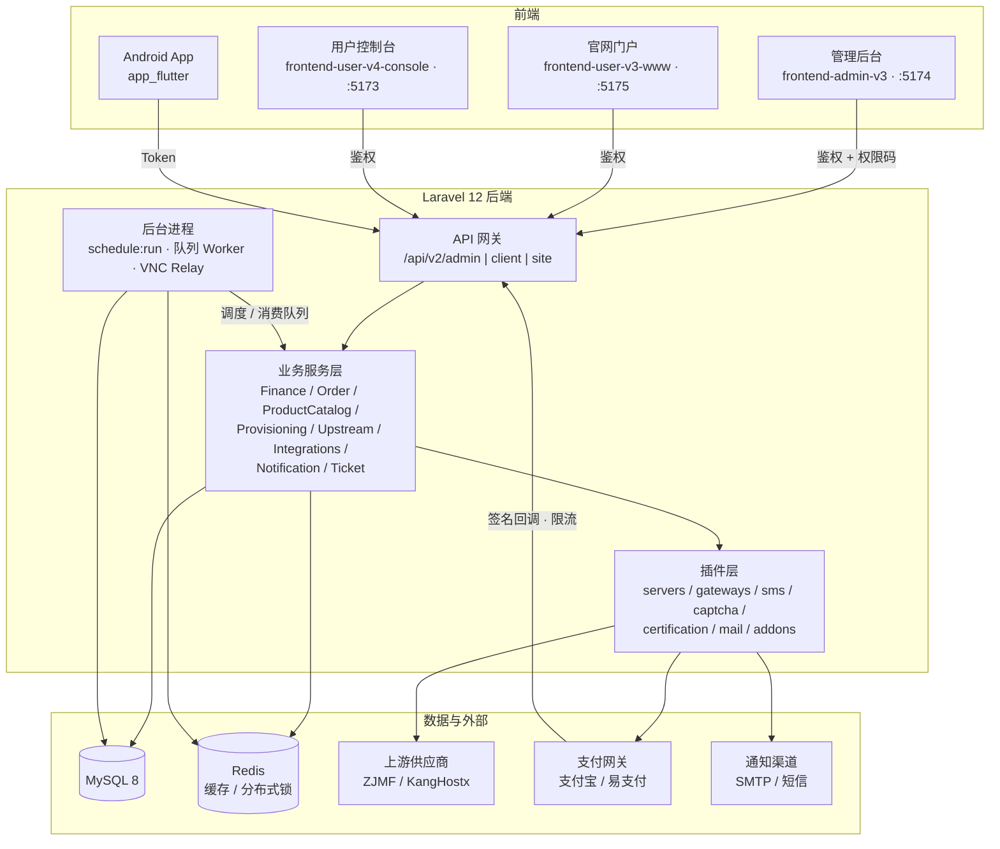

# 创欧云 Caiwu · IDC 业务与财务系统


面向 IDC / 云服务商的业务与财务经营系统。覆盖商品目录、订单计费、账单结算、自动开通、余额充值、退款、优惠券、分销返佣、提现、工单与通知等完整业务闭环，提供管理后台、官网门户、用户控制台三端 Web 前端与 Android 原生 App，并通过插件机制对接上游供应商与第三方服务。

> 本仓库仅分发源码。完整的设计文档、运维手册与执行计划由项目方本地维护，不随仓库公开。
>
> 参与开发请先阅读 [贡献指南](CONTRIBUTING.md)，安全问题请走 [安全政策](SECURITY.md)。

---

## 目录

- [核心能力](#-核心能力)
- [技术栈](#-技术栈)
- [架构总览](#-架构总览)
- [插件生态](#-插件生态)
- [目录结构](#-目录结构)
- [环境要求](#-环境要求)
- [快速开始](#-快速开始)
- [构建与验证](#-构建与验证)
- [工程与安全基线](#-工程与安全基线)
- [开源许可](#-开源许可)

---

## ✨ 核心能力

| 能力           | 说明                                                                   |
| -------------- | ---------------------------------------------------------------------- |
| 🛒 商品与计费  | 三层商品分类、产品配置与定价快照、多计费周期、自动续费、优惠券活动     |
| 📦 订单与开通  | 下单、账单结算、支付回调同步履约、上游自动开通、失败重试与自动挂起释放 |
| 💰 财务        | 余额账户、充值、退款、账单行项目、分销返佣、推广提现、账务流水         |
| 🖥️ 服务控制台  | 服务总览、开机 / 关机 / 重启、NAT、安全组与状态同步                    |
| 👤 用户体系    | 注册登录、实名认证（可选）、登录风控（账号与 IP 软锁定、验证码限流）   |
| 🎫 工单系统    | 用户端与管理端工单全流程、催办与关闭                                   |
| 🔔 通知        | 站内信、邮件、短信，模板可配置，渠道插件化                             |
| ⚙️ 自动化      | 调度任务、心跳监控、定时对账、自动续费与生命周期管理                   |
| 🔌 插件机制    | 上游服务器、支付、短信、验证码、实名认证、邮件、存储均以插件接入       |
| 🖥️ 远程运维    | App 内置 SSH 终端与 VNC 远程桌面，服务端独立中转                       |

## 🧩 技术栈

| 端         | 技术                                                                                      |
| ---------- | ----------------------------------------------------------------------------------------- |
| 后端       | PHP 8.2+、Laravel 12、Sanctum Token 鉴权、MySQL 8、Redis（缓存与分布式锁）                |
| 管理后台   | Vue 3 + TypeScript + TDesign Vue Next + Vite（`frontend-admin-v3`，开发端口 5174）        |
| 官网门户   | Vue 3 + TDesign Vue Next + Vite（`frontend-user-v3-www`，开发端口 5175）                  |
| 用户控制台 | Vue 3 + TypeScript + TDesign Vue Next + Vite（`frontend-user-v4-console`，开发端口 5173） |
| Android App | Flutter + TDesign Flutter（`app_flutter`，独立构建，含 SSH 终端与 VNC 远程桌面）          |
| 共享包     | `shared`（跨端会话、HTTP、状态、组件与状态枚举）                                          |

## 🏗️ 架构总览



关键边界：

- **记录职责分离**：`orders` 是购买契约（含配置定价快照），`invoices` 是结算凭证，`payments` 只记录真实第三方资金流入且禁止物理删除。
- **分层调用**：控制器保持薄层，业务逻辑收敛到 Service；第三方与上游调用只走插件目录或专用上游层，业务控制器不直接发外部 HTTP 请求。
- **路由统一**：业务接口统一为 `/api/v2/admin|client|site/*`。管理端走 `auth:sanctum` + `ensure.admin` + 权限码，用户端走 `auth:sanctum` + `ensure.client`，回调入口带独立签名校验与限流。
- **幂等与一致**：支付回调、订单创建、返利计算等关键业务依赖 Redis 锁与数据库唯一约束保证幂等；财务、订单、余额、返佣、开通、回调均要求事务、幂等与审计字段。
- **并发兜底**：生产每分钟 `schedule:run` 并行消费开通队列、业务队列与自动化队列，各自独立互斥；VNC Relay 独立常驻，不影响心跳、支付、新购或续费。

## 🔌 插件生态

插件按能力域收敛在 `backend/plugins/{domain}/{slug}/`，不注册系统级路由、调度或全局中间件。每个能力域均提供 `demo_*` 参考实现。

| 能力域     | 已接入插件                                                  |
| ---------- | ----------------------------------------------------------- |
| 上游服务器 | `kanghostx`、`zjmf_finance`（智简魔方财务）、`demo_servers` |
| 支付网关   | `ali_pay`（支付宝）、`yi_pay`（易支付）、`demo_pay`         |
| 短信服务   | `aliyun`（阿里云短信）、`stay33`、`demo_sms`                |
| 验证码     | `geetest`（极验）、`vaptcha`                                |
| 实名认证   | `baidu_face`（百度人脸）、`stay33`、`demo_verification`     |
| 邮件       | `smtp`、`multi_smtp_round_robin`（多 SMTP 轮询）、`demo_mail` |
| 存储扩展   | `aliyun_oss`、`qiniu`、`tencent_cos`、`ftp`、`demo_style`   |

插件配置中的敏感字段进入加密存储，前端只展示「是否已配置」与脱敏预览。

### 智简魔方财务（ZJMF Finance）兼容

通过 `plugins/servers/zjmf_finance/` 对接智简魔方财务数据面，覆盖商品、库存、开通、续费、状态同步与 ZJMF 专属能力（旧密码兼容、账单恢复）。保持独立 `zjmf_finance_api` provider key，不与其他主机面板适配器混用；适配器显式声明平台可调用方法，不使用动态转发。

## 📁 目录结构

```text
caiwu/
├── backend/                  # Laravel 12 后端
│   ├── app/                  # 控制器 / 服务 / 模型 / 命令 / 中间件
│   ├── config/               # 配置（含可选集成占位）
│   ├── database/
│   │   ├── schema/           # 完整结构基线 mysql-schema.sql
│   │   ├── migrations/       # 增量迁移（只新增，不修改历史）
│   │   └── seeders/          # 系统默认配置
│   ├── plugins/              # 插件（servers / gateways / sms / captcha / certification / mail / addons）
│   ├── routes/               # api.php / v2-admin.php / v2-client.php / web.php / console.php
│   └── scripts/              # 构建、安装与运维脚本
├── frontend-admin-v3/        # 管理后台（开发端口 5174）
├── frontend-user-v3-www/     # 官网门户（开发端口 5175）
├── frontend-user-v4-console/ # 用户控制台（开发端口 5173）
├── app_flutter/              # Android 原生 App（Flutter + TDesign Flutter，独立构建）
├── shared/                   # 跨前端共享包（会话、HTTP、状态、组件）
├── theme.css                 # 三端共用的设计令牌真源
└── tsconfig.base.json        # 三端 TypeScript 基础配置
```

## 🔧 环境要求

- PHP 8.2+（扩展：`pdo_mysql`、`redis`、`mbstring`、`openssl`、`zip`）
- MySQL 8.0+
- Redis 6.0+
- Composer 2.x
- Node.js 20.19+
- Flutter 3.8+（仅构建 Android App 时需要）

## 🚀 快速开始

> 本地联调统一使用 `127.0.0.1`，不要混用 `localhost`。

### 1. 后端

```bash
cd backend
composer install
cp .env.example .env
# 编辑 .env：DB_HOST / DB_PORT / DB_DATABASE / DB_USERNAME / DB_PASSWORD，
# 以及 APP_URL / FRONTEND_URL / CLIENT_CONSOLE_URL / ADMIN_URL（四个地址必须互不相同且协议一致）
php artisan key:generate
php artisan migrate
php artisan db:seed --class='Database\Seeders\SettingsSeeder'
```

启动开发服务（统一入口，会拉起 HTTP、VNC Relay 与业务队列 Worker）：

```bash
php artisan app:serve
```

创建管理员账号：

```bash
php artisan tinker
```

```php
App\Models\AdminUser::create([
    'username' => 'admin',
    // 必须使用强口令，安装脚本会拒绝「用户名即口令」等常见弱组合
    'password' => \Illuminate\Support\Facades\Hash::make('请替换为至少 12 位的强口令'),
    'role_id'  => 1,
    'nickname' => '管理员',
]);
```

### 2. Web 前端

```bash
# 仓库根目录安装依赖（npm workspaces 统一管理三端）
npm install

# 分别启动三端：官网 5175 / 控制台 5173 / 管理端 5174
npm run dev:user-v3-www
npm run dev:user-v4-console
npm run dev:admin-v3
```

### 3. Android App

`app_flutter/` 是独立 Flutter 工程，不接入根 npm workspace，需要单独安装 Flutter SDK 与 Android SDK。

```bash
cd app_flutter
flutter pub get
flutter run --dart-define=API_BASE=http://10.0.2.2:8000/api
```

Android 模拟器访问宿主机需用 `10.0.2.2`；真机调试请改为宿主机局域网 IP，并确认后端 `APP_URL` 可达。

## 🏗️ 构建与验证

### 前端构建

```bash
# 读取 backend/.env 中的 APP_URL / FRONTEND_URL / CLIENT_CONSOLE_URL / ADMIN_URL，
# 依次构建三端并输出到各自 dist/
npm run build:frontends

# 单独构建某一端
npm run build:admin-v3
npm run build:user-v3-www
npm run build:user-v4-console
```

`app_flutter` 不在上述脚本内，需单独执行 `cd app_flutter && flutter build apk`。

### 测试与静态检查

```bash
# 后端：静态分析与代码格式
cd backend && composer analyse && composer format:check

# 后端：单元与功能测试
cd backend && php artisan test

# 前端：共享层类型检查与测试
npm run typecheck:shared
npm run test:shared

# 前端：三端类型检查 / 构建 / 重构校验
npm run typecheck:frontends
npm run verify:frontends

# Android App（独立工程）
cd app_flutter
flutter analyze
flutter test
dart run tool/check_no_webview.dart      # 守卫：禁止任何 WebView 网页嵌套
dart run tool/check_visual_rules.dart    # 守卫：禁止渐变头 / 浮卡 / 玻璃拟态回流
```

## ✅ 工程与安全基线

- **服务端权威计算**：订单与账单金额由服务端按规则重算，客户端参数不参与计费金额裁决。
- **凭据不落地客户端**：上游凭据仅由服务端插件层持有，客户端与匿名请求无法获得原始上游令牌。
- **无越权读取**：资源查询与操作一律绑定当前用户所有权与权限码，未授权访问统一返回 403 / 404。
- **防支付重放**：支付网关回调幂等 + 队列互斥，同一笔交易只入账、只履约一次。
- **插件边界**：插件按能力域收敛于 `backend/plugins/{domain}/{slug}/`，不注册系统级路由、调度或全局中间件。
- **审计留痕**：关键资金、订单与后台操作保留审计字段，账务支持导出与归档。
- **原生渲染约束**：`app_flutter` 禁止任何 WebView 网页嵌套，由 `tool/check_no_webview.dart` 在 CI 中强制校验。

## 📄 开源许可

本项目采用**双轨授权**模式：

- **开源授权**：GNU Affero General Public License v3.0 或更高版本（AGPL-3.0-or-later），见 [LICENSE](LICENSE)。网络服务（SaaS）同样适用，防止闭源分叉。
- **商业授权**：需要在闭源或受限条件下部署、修改、二次开发的企业用户，可联系项目方获取，免除 AGPL 第 13 条网络交互开源义务。

前端 `frontend-admin-v3` 与 `frontend-user-v4-console` 基于 [TDesign Vue Next Starter](https://github.com/Tencent/tdesign-vue-next-starter) 构建，其原始代码与许可声明继续遵循 MIT，详见各前端目录下的 `LICENSE`。
