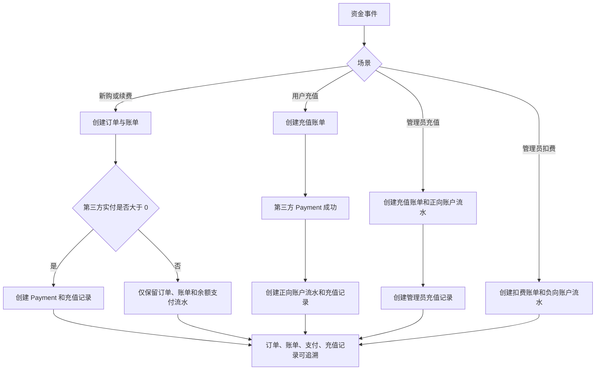

# 财务单据生成规则

## 1. 范围与实体映射

本规则覆盖新购、续费、用户充值、管理员扣费、管理员充值、补录账单、补录订单七类资金事件。

**退款功能已于 2026-10-03 移除**：管理员不再拥有在线退款入口（账单退款 / 服务退款 / 网关原路退款全部下线）。`refunds` 表、退款红字账单（`invoices.type=refund`）、账单状态 5（已退款）与 `callback_raw.refund` 仅作为历史数据保留展示与筛选，不再产生新记录；唯一保留的余额回补路径是系统自动冲正（混付取消回补、续费账单被新账单取代时的自动回余额）。

**2026-10-11 修订 → 2026-10-20 再次修订**：2026-10-11 曾新增**退款标记**通道（`refund_method=manual_mark`）并恢复管理员「退款到余额」入口（`refund_method=balance`）；2026-10-20 裁决**删除标记通道**，只保留「退款到余额」单一出口（见 §6.2）。历史 `funds_moved=0` 行只读保留。

**2026-10-21 修订**：退款改为**账单级累计口径**——可退额 = 实收基数 `max(paid_amount, amount)` − 已转余额异常支付 − 已完成退款累计；拆分支付（50+50）与分次退款不再被截断，累计退满才收口。系统外收款（补录订单/手工入账，`Payment.gateway=manual`）禁止退款到余额。详见执行计划《财务与支付审查阻断项修复计划-2026-10-21》。

项目内的术语映射如下：

| 业务术语   | 权威实体                                      | 作用                                                                                     |
| ---------- | --------------------------------------------- | ---------------------------------------------------------------------------------------- |
| 订单       | `orders` / `Order`                            | 记录服务交易和履约明细；纯账户充值、管理员余额调整可省略。                               |
| 账单       | `invoices` / `Invoice`                        | 财务主单据，记录应收、已收、充值、扣费和退款红字账单。                                   |
| 账户流水   | `account_transactions` / `AccountTransaction` | 记录现金账户余额变化，是账单支付和余额入账的流水凭证。                                   |
| 第三方支付 | `payments` / `Payment`                        | 仅记录支付宝、微信等真实外部资金流入；余额、免费、人工开通不得创建 `Payment`。           |
| 充值记录   | `recharge_records` / `RechargeRecord`         | 记录余额入账来源（退款冲抵仅存历史数据）。                               |
| 退款单     | `refunds` / `Refund`                          | 历史数据表：退款功能已移除，仅保留存量记录展示。                         |

`Invoice` 是当前架构中的账单主体，不能另建平行的 `bills` 表。`AccountTransaction` 是余额变动流水，补足账单支付、充值、扣费和退款的可审计证据。

补录场景（管理员登记系统外收付）是 `Payment` 语义的唯一例外：补录入账会创建 `gateway=manual` 的 `Payment` 行，仅作为审计凭证（`callback_raw.source=admin_manual_entry` 记录操作人与交易号），不代表任何第三方资金流入，也不生成充值记录。

## 2. 设计决策

- 每个写入由 `PaymentService` 在数据库事务和业务锁内协调，`FinanceDocumentService` 只负责单据关联、金额校验和幂等创建。
- 所有新增金额列使用 `decimal(12,2)`，所有单据和账户流水币种固定写入 `CNY`。
- 充值记录以 `payment_id` 或 `account_transaction_id` 唯一约束实现幂等；支付回调、状态轮询重复触发时不会重复建档。
- `Payment` 仍只记录第三方资金。

## 3. 数据库设计

迁移文件：

- `backend/database/migrations/2026_07_18_190000_create_finance_document_records.php`
- `backend/database/migrations/2026_07_18_191000_add_currency_to_finance_documents.php`

### 3.1 既有表的新增字段

| 表                     | 字段                | 约束/默认值                          | 用途                     |
| ---------------------- | ------------------- | ------------------------------------ | ------------------------ |
| `invoices`             | `origin_invoice_id` | 可空，外键 → `invoices.id`，删除置空 | 退款红字账单关联原账单。 |
| `orders`               | `currency`          | `char(3)`，默认 `CNY`                | 订单币种。               |
| `invoices`             | `currency`          | `char(3)`，默认 `CNY`                | 账单币种。               |
| `payments`             | `currency`          | `char(3)`，默认 `CNY`                | 第三方支付币种。         |
| `account_transactions` | `currency`          | `char(3)`，默认 `CNY`                | 账户流水币种。           |

默认值会将历史行补为 `CNY`，新写入不允许省略币种语义。

### 3.2 `refunds`（仅历史数据）

退款功能已移除，本表不再产生新行。存量行字段含义（供展示/对账）：

| 字段                                                                                 | 说明                                     |
| ------------------------------------------------------------------------------------ | ---------------------------------------- |
| `refund_no`                                                                          | 唯一退款单号。                           |
| `user_id`、`invoice_id`                                                              | 退款所属用户与原账单。                   |
| `refund_invoice_id`                                                                  | 关联本次创建的退款红字账单。             |
| `payment_id`                                                                         | 原第三方支付，可空；纯余额支付退款为空。 |
| `amount`、`currency`、`refund_method`、`status`                                      | 退款金额、币种、渠道和状态。             |
| `reason`、`operator_type`、`operator_id`、`operator_name`、`refunded_at`、`trace_id` | 退款原因、管理员审计信息、时间和链路号。 |

### 3.3 `recharge_records`

| 字段                                            | 说明                                                                     |
| ----------------------------------------------- | ------------------------------------------------------------------------ |
| `record_no`                                     | 唯一充值记录号。                                                         |
| `user_id`、`order_id`、`invoice_id`             | 用户、订单和账单关联；无订单场景允许 `order_id` 为空。                   |
| `payment_id`                                    | 第三方支付关联，唯一且可空。                                             |
| `account_transaction_id`                        | 账户流水关联，唯一且可空。                                               |
| `refund_id`、`origin_recharge_record_id`        | 退款单及被冲抵的原充值记录（仅历史数据）。                               |
| `scene`                                         | `new_purchase`、`renewal`、`user_recharge`、`admin_recharge`、`refund`。 |
| `direction`、`amount`、`currency`、`entry_type` | 收入/冲抵方向、两位小数金额、`CNY`、具体来源类型。                       |
| `remark`、`operator_*`、`trace_id`              | 业务备注、管理员审计和链路追踪。                                         |

关键索引：`invoice_id`、`order_id`、`origin_recharge_record_id`、`user_id + created_at`；退款冲抵通过自关联记录可完整追溯。

## 4. 七类场景规则

| 场景       | 必建单据                                           | 充值记录                           | 金额与关联规则                                                                               |
| ---------- | -------------------------------------------------- | ---------------------------------- | -------------------------------------------------------------------------------------------- |
| 新购       | `Order` + `Invoice`                              | 仅第三方实付金额大于 0 时创建      | 充值记录关联订单、账单、支付；混合支付仅记录第三方部分。                                     |
| 续费       | `Order` + `Invoice`，`type=renew`                | 同新购                             | 支付完成时校验 `账单金额 = 余额支付额 + 第三方支付额`。                                      |
| 用户充值   | `Invoice(type=recharge)` + `AccountTransaction`  | 必建                               | 充值记录绑定账单、第三方支付和余额入账流水；当前纯账户充值不建订单。                         |
| 管理员扣费 | `Invoice(type=deduction)` + `AccountTransaction` | 禁止创建                           | 记录操作人、时间、原因、用户和链路号。                                                       |
| 管理员充值 | `Invoice(type=recharge)` + `AccountTransaction`  | 必建                               | `remark` 固定为“管理员手工充值”，并记录操作人、时间、原因。                                  |
| 补录账单   | `Invoice(type=manual)` + `Payment(gateway=manual)` | 禁止创建，不动余额               | 仅记账：无订单、无账户流水；`callback_raw.source=admin_manual_entry` 留操作人/交易号审计。   |
| 补录订单   | `Order(直接已支付)` + `Invoice(投影 type)` + `Payment(gateway=manual)` | 禁止创建，不动余额 | 仅 `new`/`renew`/`upgrade`，实例归属强校验；固定不触发开通/续期业务流转；同实例有待支付订单时拒绝。 |

退款场景曾于 2026-10-03 全量下线；2026-10-11 恢复「退款到余额」入口（见 §6.2）并新增纯标记通道（不动资金，见 §6.2.1），两者一单只选一种。系统自动冲正（混付取消回补 `restoreReservedMixBalance`、续费账单被新账单取代时回余额）不受影响。

金额约束：

1. 新购和续费：订单金额、账单金额、余额支付额与第三方支付额之和必须一致；存在充值记录时，记录金额等于第三方实付额。
2. 用户充值、管理员充值：充值记录金额必须与充值账单和正向账户流水金额一致。
3. 管理员扣费：账户流水金额为负数，不得创建充值记录。
4. 所有金额以数据库 `decimal(12,2)` 保存，服务写入时统一格式化为两位小数。

## 5. 业务流程图



> 退款分支已随退款功能移除（2026-10-03）。

## 6. 对外接口契约

系统复用既有 v2 管理端路由，不新增平行接口。统一成功响应保持 `code = 0`。

### 6.1 管理员余额调整

`POST /api/v2/admin/users/{user}/recharges`

- 权限：`user.recharge`
- 请求体：

```json
{
  "amount": 100.0,
  "remark": "活动补偿充值"
}
```

- `amount > 0` 为管理员充值，`amount < 0` 为管理员扣费；不得为 0。
- `remark` 必填，最大 200 个字符。
- 响应中的 `detail.documents` 为新增关联信息：

```json
{
  "code": 0,
  "data": {
    "id": 42,
    "status": "completed",
    "message": "余额增加成功",
    "detail": {
      "type": "balance_adjustment",
      "user": { "id": 42 },
      "adjustment": { "amount": "100.00", "direction": "increase" },
      "documents": {
        "invoice_id": 501,
        "account_transaction_id": 801,
        "recharge_record_id": 901
      }
    }
  }
}
```

扣费时 `recharge_record_id` 为 `null`。

### 6.2 管理员退款接口（2026-10-11 恢复余额退款）

`POST /api/v2/admin/invoices/{invoice}/refunds`——管理员把账单退款**到用户余额**（`refund_method=balance`）：加余额 + 台账 `INVOICE_REFUND` + 红字账单（`invoices.type=refund`）+ 充值记录，全链路事务化并持有账单/用户行锁。权限复用 `finance.refund`；充值/补录账单不得退回余额（资金从未离开系统）；推广奖励可提余额不足时阻断。

**2026-10-20 裁决更新**：纯标记通道（`refund_method=manual_mark`）已整体移除，两条 `refund-marks` 路由、`InvoiceRefundMarkService` 与互斥守卫一并删除。历史 `finance_refunds` 中 `funds_moved=0` 的行只读保留，不回填、不删除。

> 历史：2026-10-03 曾下线全部退款入口；2026-10-11 在「标记已退款」需求中一并恢复余额退款；2026-10-20 删除标记通道，仅保留**退款到余额**单一出口，仍**不提供原路退款**（支付插件层无退款能力与契约）。

### 6.2.1 已删除：退款标记接口

`POST /api/v2/admin/invoices/{invoice}/refund-marks` 与 `POST /api/v2/admin/orders/{order}/refund-marks` 已于 2026-10-20 随 `manual_mark` 通道一并下线，当前 `route:list` 无此路由。

> 若需登记「线下已退款事实」，改用 `POST /api/v2/admin/invoices/{invoice}/refunds`（真实退回余额）。

### 6.3 管理员补录账单

`POST /api/v2/admin/users/{user}/manual-invoices`

- 权限：`invoice.manual_entry`（专用权限码，默认不下发任何内置角色，仅 super_admin 可授权）
- 语义：登记系统外收付，仅记账，不改变用户余额、不产生账户流水与充值记录。
- 请求体：

```json
{
  "amount": 88.5,
  "paid_at": "2026-09-23 10:00:00",
  "trade_no": "OFFLINE-20260923-001",
  "payment_gateway": "bank_transfer",
  "remark": "线下收款补录"
}
```

- `amount` 必填，`0.01 ~ 999999`，最多两位小数；`type` 服务端锁死 `manual`，不接受前端传入。
- `paid_at` 可省略（默认当前时间），不得晚于当前时间；`trade_no` 可省略，填写时按用户查重（同用户已有相同交易号的支付记录即拒绝）。
- `payment_gateway` 必填，枚举 `cash|bank_transfer|alipay|wechat|other`（线下收款渠道）。**仅作审计记录**：写入 `Payment.callback_raw.payment_gateway` 与操作日志，`Payment.gateway` 对账权威口径固定 `manual`，此值不参与网关路由与对账。
- 入账为两步一事务：`createDirect`（`type=manual`、待支付）→ `markPaidManually`（`sync_business_flow=false`），产出 `Invoice(type=manual, status=PAID)` 与 `Payment(gateway=manual, status=SUCCESS)`。
- 审计：`Payment.callback_raw` 记录 `source=admin_manual_entry`、`operator_id`、`operator_name`、`trade_no`、`remark`；`OperationLogService` 写 `invoice.payment.mark_paid`。

### 6.4 管理员补录订单

`POST /api/v2/admin/users/{user}/manual-orders`

- 权限：`order.manual_entry`（专用权限码，默认不下发）
- 约束：仅接受 `type=new|renew|upgrade`；`service_id` 必填且必须归属路由用户；该实例存在待支付订单时拒绝；固定不触发开通/续期业务流转（实例状态与到期时间不变）。
- `new` 用于登记系统外收款的新购（实例必须已存在，补录只记账、不创建实例）；需要连实例一起创建时仍走「添加实例」`POST /users/{user}/services`。
- 请求体：

```json
{
  "service_id": 12,
  "type": "renew",
  "amount": 200.0,
  "billing_cycle": "monthly",
  "trade_no": "OFFLINE-20260923-002",
  "payment_gateway": "bank_transfer",
  "remark": "线下续费补录"
}
```

- 入账为同一事务三步：`Order::create`（待支付）→ `InvoiceService::createFromOrder` 投影账单（`renew→Invoice(type=renew)`、`upgrade→Invoice(type=upgrade)`、`new→Invoice(type=normal)`）→ `markPaidManually`，订单与账单被置为已支付并补 `Payment(gateway=manual)`。
- 补录订单写入 `config_snapshot.admin_manual=true`（与「添加实例」建单同款标记）：支付窗口按账期计、且不被自动清理（口径见 §6.6），并让履约入口识别为人工挂账单而不自动开通。
- `billing_cycle` 可省略，默认跟随实例当前周期；`payment_gateway` 语义同 6.3（必填枚举，仅审计记录）。

### 6.5 充值幂等键

`POST /api/v2/admin/users/{user}/recharges` 请求体新增可选 `idempotency_key`（最长 64 字符）：

- 传入时以 `lock:admin:balance-adjust:{user_id}:{md5(key)}` 做缓存占位（10 分钟）：同一键 10 分钟内仅入账一次，重复请求直接拒绝；入账失败释放占位允许修正重试，成功后保留占位拦截重放。
- 前端在打开充值对话框时生成 UUID，提交复用；省略该键时保持既有行为（仅用户行锁）。

### 6.6 支付会话窗口与过期清理

- 普通账单/订单的支付会话窗口为 `created_at + 300 秒`（`CheckoutSecurityService::PAYMENT_SESSION_TTL_SECONDS`）：窗口过后 `payment_options.payment_security.can_pay=false`、`session_token` 为空，请求路径懒清理（账单列表/详情、支付入口）与定时清理（`InvoiceCleanupAutomationService`）都会把这类单据关闭。
- 窗口长度是**风控要求**，不是可调体验参数（2026-10-28 产品确认）：`session_token` 与收银台 `timeout_express`（`PaymentGatewayFlow` 按窗口推导，钳制 1 分钟~15 天）同源于它，缩短会直接压缩网关侧可付款时长，因此不按页面停留时长逐个放宽。300 秒对存量支付成功率已经足够（网关侧只消费 `timeout_express`，用户在网关页面停留超过 5 分钟属异常场景，超时后仍可重新发起），故**维持 300 秒，不做更短调整**；若要改动必须同步评估网关超时与用户端倒计时文案（`useInvoiceDetailHelpers` 读 `payment_security.expires_at`，`invoice-detail` 渲染 `summary-session__countdown`），属跨端契约变更，须先立执行计划。
- 按账期收款的账单窗口跟随 `due_date`：`invoices.type = renew` 的续费账单与 `config_snapshot.admin_manual=true` 的管理员挂账单（含其影子订单）以 `due_date` 当日 `23:59:59` 为窗口结束，与到期前 1/3/5 天提醒、逾期催收同一口径；`due_date` 为空时回落 5 分钟窗口（续费建单与补录建单均显式写入 `due_date`，见 §6.4）。
- 唯一的取消豁免是挂账单据：`config_snapshot.admin_manual=true` 的账单与其影子订单无论是否逾期都不自动取消，豁免收口在 `CheckoutService::cancelExpiredUnpaidInvoice()`（账单侧）与 `OrderService::cancelExpiredPendingOrder()`（订单侧，含订单详情单条懒清理 `GET /api/v2/client/orders/{id}`），请求路径与定时任务共用同一入口，避免两套口径。订单侧必须同样豁免：取消订单会经 `TradeLifecycleService::cancelTrade()` 级联取消关联挂账单，用户会同时失去订单与账单的支付入口；被豁免的挂账订单须由管理端显式取消。逾期后用户端显示「支付窗口已关闭」，须由管理员线下结清或手工标记已支付。
- 挂账订单的终态收敛不含「用户不动作」的场景，共三条通道，覆盖「账单已被取消但订单还停在待支付」这一豁免副作用：
  - 自动（定时任务）：`InvoiceCleanupAutomationService::cancelAbandonedAdminManualOrders()` 在 `order-cleanup` 执行时回收待支付 + `config_snapshot.admin_manual=true` + 关联账单已 `CANCELLED` 且该账单 `updated_at` 已超过 7 天的订单，走 `OrderService::cancel()`（原因 `admin_manual_abandoned`），汇总键 `abandoned_orders_cancelled`。宽限期取 7 天与账单默认账期一致；`invoices` 与 `orders` 表都没有 `cancelled_at`，取消必然 `forceFill()->save()` 刷新 `updated_at` 且挂账单取消后不再有写入，故用 `invoices.updated_at` 近似取消时刻。
  - 人工（管理端）：`POST /api/v2/admin/orders/{order}/cancellations`，权限码 `order.manage`（限流 `throttle:20,1,admin-order-cancel`），服务端固定写取消原因 `admin_order_cancel`，取消逻辑复用 `OrderService::cancel()`；入口在订单详情页工具栏「取消订单」，仅待支付可见。无关联账单的挂账订单（管理端只建订单不建账单）也由这条通道收口。
  - 自助（用户端）：`POST /api/v2/client/orders/{order}/cancellations`（`ClientActionV2Service::cancelOrder()`，限流 `throttle:10,1,client-orders-cancel`）同样复用 `OrderService::cancel()`，**不判断 `admin_manual` 标记**——用户可在管理端不知情时自行取消挂账订单（并级联取消关联挂账单）。这是既有行为，接口不区分订单来源；若业务要求挂账订单只能由管理端取消，需要另外加拦截，属产品决策，当前未做。
  - 三条通道都不取消仍处于支付窗口内的挂账单据：自动通道要求「关联账单已取消」，人工通道需管理员主动操作，自助通道需用户主动操作，均不影响正常挂账收款。
  - 「未付款账单清理」开关（`pending_order_cleanup_enabled`）关闭时只停账单/订单/充值单的超时自动取消，**不停上面的自动收敛通道**：收敛对象是已无可收款路径的僵尸单，跟着开关一起停会让「关开关即复发」。管理端开关说明文案已同步写明这一点。
- 过期清理的候选集 SQL 收窄：`CheckoutSecurityService::applyExpiredInvoiceSweepScope()` / `applyExpiredOrderSweepScope()` 在请求路径（`CheckoutService::cancelExpiredUnpaidInvoicesForUser`、`OrderService::cancelExpiredPendingOrdersForUser`）与定时任务（`InvoiceCleanupAutomationService`）共用，账期内的续费账单/影子订单不再进入候选集；挂账标记藏在 `config_snapshot` JSON 内，MySQL 可以用 `JSON_EXTRACT`/`JSON_UNQUOTE` 判定（仓库已有同类先例，如 `RetryFailedProvisionCommand`），但该表达式无法命中索引、每次都要回表逐行求值，因此不做 SQL 收窄，仍留在候选集里由上面两层豁免拒绝。
- 续费账单过期后重新发起续费：`ServiceRenewService::createRenewInvoiceForUser` 只在同一周期存在**窗口未过**的待支付账单时复用，窗口已过则取消旧账单（原因 `payment_window_expired`）并新建，用户始终拿到一张可支付的续费账单。
- 列表接口 `GET /api/v2/client/invoices` 与订单列表/详情接口（`GET /api/v2/client/orders`、`/orders/{id}` 的 `invoice.payment_window_expired`）下发只读标记 `payment_window_expired`（与详情接口 `can_pay` 同一判据），窗口已关闭的待支付账单在前端不给「去支付」入口：账单列表、账单详情页、订单列表、订单详情页四处口径一致。
- 订单页的支付入口判据比账单页多两道前置：订单本身待支付（`status=0`）、关联账单存在且仍待支付（`invoice.id` 为正整数、`invoice.status=0`）。管理端只建订单不建账单时会下发 `invoice=null`，此时前端拼不出支付页地址，直接不给入口并显示「无可支付账单」，不得回落成 `/client/invoices/undefined/pay`；账单已取消/已支付等非待支付状态同样按「无可支付账单」处理，且不能套用「支付窗口已关闭」的结论（那是窗口维度的独立判定）。
- 支付入口并发：余额支付、网关支付、组合支付共用账单级锁 `lock:pay:invoice:{invoice_id}`；后到的支付款按异常捕获规则转入余额（`MixPaymentService::creditCapturedPaymentToBalance`），并写 `payment_credited_to_balance` 站内信告知用户「钱已到账、账单未支付」。

## 7. 审计与安全边界

- 管理端接口使用 Sanctum 管理员认证与既有权限中间件；控制器只传递已校验请求给服务层。
- 管理员充值、扣费写入操作人、操作时间、原因/备注、用户、账单和 `trace_id`。
- 补录账单/补录订单挂专用权限码 `invoice.manual_entry` / `order.manual_entry`，两者均不在 `adminDefaultPermissions()` 默认下发清单中，避免随 `invoice.manage` / `order.manage` 对全体管理员静默提权；服务层强制 `service_id` 归属校验与 `trade_no` 按用户查重。
- 已入账的手工补录账单暂无撤销接口（cancel 仅限待支付）：错录需走红字冲抵方案（未实现，见执行计划）。
- 退款：错收/需退款场景可用 2026-10-11 恢复的「退款到余额」（动资金，见 §6.2）或纯标记（只登记不动钱，见 §6.2.1），两者一单只选一种；亦可通过「管理员充值/扣费」人工调整或线下处理。
- 余额调整、充值回调和自动回补均在事务内处理；支付回调和充值记录以唯一键保证幂等，管理员充值额外支持 `idempotency_key` 占位幂等。
- 不返回第三方回调原文、密钥、令牌或敏感账户信息；接口只返回可追溯的内部单据 ID。
