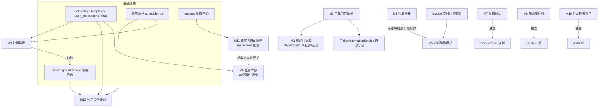

# 功能模块扩展设计方案 · 2026-10-11

## 背景

用户新增 11 个功能模块需求（原编号 1/2/3/5/6/7/8/9/10/11/12，**编号 4 未提供**，本文保留原编号便于对齐）。本文档为**设计方案**：逐项给出数据结构（表结构建议）、接口设计与实现要点，并给出模块间依赖关系与分期建议。**实现须按分期批次另行立项，本文档不直接触发代码改动。**

## 现状关键事实（已读码核实）

1. `invoices.status` 为四态 tinyint：0 待支付 / 1 已支付 / 4 已取消 / 5 已退款（`2026_08_29_110000` 归一迁移）；`invoices` 已有自引用 `origin_invoice_id`（续费语义），合并账单**不得复用**该列。
2. `tickets.department` 目前是**字符串列**（`app/Models/Ticket.php`），无部门实体表；`assignee_id → admin_users` 已存在；`TicketAutomationService` 已存在可承载自动分派。
3. 登录邮件提醒**已实现**：`users.login_email_alert / login_notify / login_location_alert` 用户级开关 + `AuthService` 发送链路（管理员代登录不触发）。模块 10 是补全而非新建。
4. 实名认证字段齐备：`users.is_verified / verification_status / verified_at`，审核历史 `VerificationHistory`；用户表**无生日字段**（生日关怀需新增 `birth_date`）。
5. 通知基建齐备：`notification_templates`（channel/code/variables_json）、`user_notifications`（站内信）、`MailDriverManager`（SMTP 插件化）。
6. 推广大使体系已独立（`promotion_ambassadors` + `referral_rewards`，`referral_rewards.invoice_id` 唯一）：内部销售提成必须与其**口径解耦**，且提成记录防重复计提应同样以 invoice 粒度唯一约束。
7. `products.config_options` 为 JSON 列，元素结构 `{field,label,option_type,unit,sort_order,display_index,sub_options:[{id,value,label,…}],qty_min,qty_max}`（范围/滑块型不从 sub_options 取值）。
8. 知识库为 `content_articles` + `content_categories`；无标签体系。
9. 权限体系：`App\Support\AdminPermissions` 点分码 + implied 展开 + 内置角色三档；资金写入类权限码默认不下发内置角色（仅 super_admin 可授权）。
10. 调度基建齐备：`ScheduleTick / ScheduleTaskRun / schedule:run`；`BillingAutomationService` 等自动化服务已存在——**到期提醒可能已部分存在，模块 12 落地前须盘点去重**。

## 全局约定（所有模块遵守）

- **分层**：Controller → Service（`app/Services/<域>/`）→ Model；Resource 统一 `app/Http/Resources/<端>/V2/`；路由挂 `routes/v2-admin.php` / `routes/v2-client.php`。
- **金额**：`decimal(12,2)` + `App\Support\Money` 格式化；涉及资金写入的表带 `trace_id`（`EnsuresTraceId` trait）。
- **状态列**：tinyint + 列 COMMENT 显式枚举中文（与既有迁移风格一致）。
- **权限**：新权限码在 `AdminPermissions` 常量 + `PermissionCatalogService` 登记 + admin-v3 `permissions.ts` 同步；资金/高危类权限码默认不下发内置角色。
- **审计**：管理端敏感操作写 activity log（`event` 命名 `<域>.<动作>`）；服务过户等资产变更复用 `service_operation_logs`。
- **快照哲学**：计价规则、模板内容、方案费率在交易发生时快照落库，事后配置变更不追溯历史单。
- **迁移**：新增列默认值显式化；存量回填单独迁移且幂等；不动既有枚举值域。

---

## M1 账单合并

### 目标

将同一用户的**多张待支付账单**（status=0）合并为一张总账单统一支付；原账单保留全部自身数据，与总账单保持关联，支付成功后原子化联动结清。

### 数据结构

**`invoices` 新增列**：

| 列 | 类型 | 说明 |
| --- | --- | --- |
| `merged_into_id` | bigint unsigned NULL，FK→invoices.id（ON DELETE SET NULL） | 子账单→所属总账单；NULL 即未被合并 |
| `merge_role` | tinyint NOT NULL DEFAULT 0，COMMENT '合并角色：0普通 1合并总账单' | 区分总账单，避免动 `type` 枚举（全链路 type 白名单不改） |
| `merged_at` | datetime NULL | 合并时间 |

索引：`(user_id, status, merged_into_id)`（合并候选查询）、`merged_into_id`。

**新表 `invoice_merge_items`**（子账单关联快照，主键 id）：

| 列 | 类型 | 说明 |
| --- | --- | --- |
| `master_invoice_id` | bigint unsigned，FK→invoices.id | 总账单 |
| `child_invoice_id` | bigint unsigned，**unique**，FK→invoices.id | 子账单，唯一约束防重复挂载 |
| `child_invoice_no` | varchar(64) | 子账单号快照 |
| `amount_snapshot` | decimal(12,2) | 合并时子账单金额快照（拆分核对用） |
| `created_at` | timestamp | — |

索引：`master_invoice_id`。

### 接口设计（管理端，`invoice.manage`）

| 方法 | 路径 | 说明 |
| --- | --- | --- |
| POST | `/v2/admin/invoices/merge` | body：`user_id` + `invoice_ids[]`；校验同用户、同币种、全部 status=0、均未被合并；事务+行锁生成总账单 |
| POST | `/v2/admin/invoices/{invoice}/unmerge` | 仅总账单未支付时可拆；解除 `merged_into_id`、删关联、总账单作废（status=4） |
| GET | `/v2/admin/invoices/{invoice}/merge-items` | 总账单子账单清单 |

客户端首版**不开放**自助合并（待裁决项见 §待裁决）。

### 实现要点

- **锁序**：合并前 `whereIn id ORDER BY id lockForUpdate`，逐张复核 `status=0 && merged_into_id IS NULL`，防与支付回调竞态。
- **总账单口径**：`amount = Σ子账单.amount`、`discount`/`member_discount_amount` 求和、`due_date = MIN(子账单)`、`invoice_no` 用 `OrderInvoiceNoGenerator::buildInvoiceNo(now, 'M')` 后缀生成；`type` 取首张子账单，`remark` 记「合并账单，含 N 张」。
- **明细投影**：总账单**不走** `syncInvoiceItemProjection`（其单行全删重建语义会互相覆盖）；合并服务直接向 `invoice_items` 写 N 行（`item_type` 沿用归一后的白名单值，`meta_json` 带 `child_invoice_no`），或首版仅靠 `invoice_merge_items` 关联表展示——**推荐后者**，减少对 item_type 白名单的触碰。
- **支付回调联动**：`PaymentService` 收款成功判定 `merge_role=1` → 同一事务内逐张子账单置已支付（各自 `paid_amount`/`paid_at`）、总账单置已支付；任一失败整体回滚。
- **取消/过期**：总账单取消（人工或超时清理）→ 子账单解除 `merged_into_id` 回到独立待支付；`InvoiceCleanupAutomationService` 需感知 merge_role。
- **防重复计提**：若 M5 提成已上线，提成以**子账单** invoice 粒度计提（`sales_commissions.invoice_id` 唯一），总账单本身不产生提成记录。
- 退款口径（总账单已付后的部分退款分摊）为**待裁决项**，裁决前总账单不支持退款入口。

---

## M2 工单预设回复库

### 目标

管理员维护分类的预设回复模板（支持占位符），客服处理工单时一键插入渲染。

### 数据结构

**新表 `ticket_preset_reply_categories`**：`id`、`name varchar(50) unique`、`sort_order int default 0`、`is_enabled tinyint default 1`、timestamps、softDeletes。

**新表 `ticket_preset_replies`**：

| 列 | 类型 | 说明 |
| --- | --- | --- |
| `category_id` | bigint unsigned NULL，FK→ticket_preset_reply_categories（SET NULL） | 分类 |
| `department_id` | bigint unsigned NULL，FK→ticket_departments（SET NULL） | 限定部门（NULL=通用）；依赖 M3 |
| `title` | varchar(100) | 模板名 |
| `content` | text | 内容，支持占位符 |
| `is_enabled` / `sort_order` / `usage_count int default 0` | — | 启用/排序/使用计数 |
| `created_by` | bigint unsigned，FK→admin_users | 创建人 |
| timestamps / softDeletes | — | — |

索引：`(category_id, is_enabled)`、`(department_id, is_enabled)`。

### 接口设计

| 方法 | 路径 | 权限 | 说明 |
| --- | --- | --- | --- |
| GET/POST/PUT/DELETE | `/v2/admin/ticket-preset-replies[/{id}]` | `ticket.manage` | 模板 CRUD |
| GET/POST/PUT/DELETE | `/v2/admin/ticket-preset-reply-categories[/{id}]` | `ticket.manage` | 分类 CRUD |
| GET | `/v2/admin/ticket-preset-replies?category_id=&department_id=&keyword=` | `ticket.reply` | 客服使用列表（回复框侧栏） |

占位符在**前端插入时替换**为主，服务端 `TicketPresetReplyService::render()` 提供兜底：`{{user_email}}`、`{{user_nickname}}`、`{{ticket_subject}}`、`{{ticket_id}}`、`{{service_name}}`。

### 实现要点

- 使用即 `usage_count` 原子自增（`increment()`），用于排序参考与冷热统计。
- M3 未上线前 `department_id` 全量 NULL，接口参数缺省兼容；M3 上线后按客服所属部门过滤可选模板。
- 软删保留审计；删除分类时其下模板 `category_id` 置 NULL 而非级联删。

---

## M3 工单部门体系

### 目标

多部门实体化、工单按部门自动分派与手动转派、客服按部门限定数据范围（部门级权限）。

### 数据结构

**新表 `ticket_departments`**：`id`、`name varchar(50) unique`、`description varchar(255) NULL`、`auto_assign_mode tinyint default 0 COMMENT '0手动 1轮询 2最少负载'`、`is_enabled tinyint default 1`、`sort_order`、timestamps、softDeletes。

**新表 `ticket_department_staff`**：`id`、`department_id`、`admin_user_id`、`is_leader tinyint default 0`，**unique(department_id, admin_user_id)**，index(admin_user_id)。客服的部门归属即部门级权限依据。

**`tickets` 变更**：

| 列 | 说明 |
| --- | --- |
| `department_id` bigint unsigned NULL，FK→ticket_departments | 新真源；迁移按现存 `department` 字符串 distinct 建部门并回填 |
| `department`（字符串列） | **保留**为冗余展示列，同步回填，后续再评估移除 |

**新表 `ticket_transfer_logs`**：`id`、`ticket_id`、`from_department_id`、`to_department_id`、`from_assignee_id`、`to_assignee_id`、`reason varchar(255)`、`operator_id`、`created_at`。

### 接口设计

| 方法 | 路径 | 权限 | 说明 |
| --- | --- | --- | --- |
| GET/POST/PUT/DELETE | `/v2/admin/ticket-departments[/{id}]` | `ticket.manage` | 部门 CRUD |
| PUT | `/v2/admin/ticket-departments/{id}/staff` | `ticket.manage` | 全量设置成员（body：`staff_ids[]` + `leader_ids[]`） |
| POST | `/v2/admin/tickets/{ticket}/transfer` | `ticket.reply`（转派） | body：`to_department_id`、可选 `to_assignee_id`、`reason` |
| GET | `/v2/client/ticket-departments` | 客户端 | 启用中部门列表（提单选择） |

### 实现要点

- **部门级权限（数据范围，非新权限码）**：`ticket.list/reply` 持有者若在 `ticket_department_staff` 有部门归属 → 工单查询自动限定 `department_id IN (所属部门)`；无任何部门归属 → 保持现状全量（向后兼容，待裁决确认）；`super_admin(*)` 永远全量。
- **自动分派**：扩展 `TicketAutomationService`——新工单落 `default_department_id`（settings）后按 `auto_assign_mode` 选人：轮询（部门成员按 `id` 循环，状态存 settings 或内存缓存）；最少负载（COUNT 未结工单最少者）。无可用成员则 `assignee_id` 置 NULL 仅落部门。
- **存量迁移**：迁移 ①建表；②`distinct department` 非空值建部门（幂等）；③`tickets.department_id` 回填 + 冗余列同步；④`ticket.default_department_id` settings 初始化。迁移不可逆方向仅建表/加列，回填幂等可重跑。
- **转派**：换部门时若未指定 `to_assignee_id` → 立即按目标部门自动分派；写 `ticket_transfer_logs`；客户端可见「已转至 X 部门处理」提示（回复流水带系统记录）。
- 客户端提单接口 `POST /v2/tickets` 增可选 `department_id`（校验启用中），未传走默认部门。

---

## M5 内部销售提成体系

### 目标

按**内部销售**（管理员/员工）的客户归属计算提成：支持阶梯佣金与按产品差异化比例；与既有「推广大使」用户返利体系并行且口径解耦。

### 数据结构

**`users` 新增列**：`sales_owner_admin_id` bigint unsigned NULL，FK→admin_users（SET NULL），index。客户归属销售；**只影响归属后新支付的账单，不追溯历史**。

**新表 `sales_attribution_logs`**：`id`、`user_id`、`from_admin_id`、`to_admin_id`、`reason varchar(255)`、`operator_id`、`created_at`——归属变更留痕（防抢客纠纷）。

**新表 `sales_commission_plans`**：`id`、`name`、`basis tinyint default 1 COMMENT '1实付金额 2订单金额'`、`is_enabled`、`valid_from date NULL`、`valid_to date NULL`、`remark`、timestamps。

**新表 `sales_commission_tiers`**（阶梯）：`id`、`plan_id`、`min_amount decimal(12,2)`、`max_amount decimal(12,2) NULL`（NULL=∞）、`rate decimal(5,2)`（百分比）；unique(plan_id, min_amount)，区间不允许重叠（服务层校验）。

**新表 `sales_commission_product_rates`**（按产品）：`id`、`plan_id`、`product_id`、`rate decimal(5,2) NULL`、`fixed_amount decimal(12,2) NULL`（二选一），unique(plan_id, product_id)。

**新表 `sales_commissions`**（计提记录）：

| 列 | 类型 | 说明 |
| --- | --- | --- |
| `admin_user_id` / `user_id` | bigint unsigned | 受益销售 / 客户 |
| `order_id` | bigint unsigned NULL | 关联订单 |
| `invoice_id` | bigint unsigned，**unique**，FK→invoices | 计提粒度=账单，唯一约束防重 |
| `plan_id` / `plan_snapshot` | — / json | 命中方案与费率快照 |
| `base_amount` / `rate` / `commission_amount` | decimal(12,2) / decimal(5,2) / decimal(12,2) | 计提基数/费率/金额 |
| `status` | tinyint COMMENT '0待结算 1已入批次 2已发放 3已取消' | — |
| `settlement_id` | bigint unsigned NULL | 所属结算批次 |
| `settled_at` / `trace_id` | — | — |

**新表 `sales_commission_settlements`**（结算批次）：`id`、`admin_user_id`、`period_start`、`period_end`、`total_amount`、`commission_count`、`status tinyint COMMENT '0待审核 1已发放 2已驳回'`、`operator_id`、`settled_at`、timestamps。首版发放为**线下发放的管理登记**（与退款标记「纯登记不动钱」哲学一致），不入用户余额、不写资金台账。

### 接口设计

| 方法 | 路径 | 权限 | 说明 |
| --- | --- | --- | --- |
| GET | `/v2/admin/sales-commissions?status=&admin_user_id=&date_range=` | `sales_commission.list` | 计提记录 |
| GET/POST/PUT/DELETE | `/v2/admin/sales-commission-plans[/{id}]` | `sales_commission.manage` | 方案/阶梯/产品费率 |
| POST | `/v2/admin/users/{user}/sales-owner` | `sales_commission.manage` | 设置归属（写 attribution log） |
| GET/POST | `/v2/admin/sales-commission-settlements[/{id}]` | `sales_commission.settle` | 批次创建/审核发放/驳回 |

新权限码：`sales_commission.list` / `sales_commission.manage` / `sales_commission.settle`（implied：manage→list，settle→list）；**settle 默认不下发内置角色**。

### 实现要点

- **计提时机**：支付成功回调（Invoice 置已支付处，与推广返利同链路挂点）→ 查客户归属 → 命中启用中的方案（有效期校验）→ 费率优先级：**产品比例 > 阶梯 > 无（不计提）**→ 写 `sales_commissions`（快照）。
- **防重**：`invoice_id` 唯一约束 + 幂等（重复回调 upsert skip）；M1 合并账单场景以子账单计提，总账单不重复计提。
- **冲正**：账单后续被退款/取消 → 对应计提记录置 `status=3 已取消`（已入批次未发放的可自动剔除；已发放走线下追偿登记，首版不自动冲账）。
- **与推广大使关系**：建议并存（销售拿提成、推荐人拿返利，来源不同互不抵扣），成本双算风险由运营在定价中消化——**待裁决确认**。
- 报表：按销售聚合月度计提/发放（管理端首页卡可选，二期）。

---

## M6 服务转移（用户间过户）

### 目标

将用户名下产品/服务安全转移至另一用户：发起 → 双方确认 → 风险校验 → 原子生效，全程留痕可审计。

### 数据结构

**新表 `service_transfers`**：

| 列 | 类型 | 说明 |
| --- | --- | --- |
| `service_id` | bigint unsigned，FK→services | 目标服务；**同一服务存在进行中的转移则拒绝**（唯一性由服务层+部分状态索引保证） |
| `from_user_id` / `to_user_id` | bigint unsigned，FK→users | 转出/接收方；不允许 from=to、不允许接收方被封禁 |
| `status` | tinyint COMMENT '0待对方确认 1双方已确认待生效 2已完成 3已取消 4已拒绝 5已过期' | — |
| `initiated_by` | tinyint COMMENT '1转出方 2接收方 3管理员' | — |
| `from_confirmed_at` / `to_confirmed_at` | datetime NULL | 双方确认时间 |
| `expires_at` | datetime | 确认有效期（默认 72h，超时批量置过期） |
| `risk_flags` | json NULL | 生效前最后一次风险校验快照（未结账单/状态/频控等） |
| `reject_reason` | varchar(255) NULL | — |
| `operator_id` | bigint unsigned NULL | 管理员操作时 |
| `trace_id` / timestamps | — | — |

索引：`(to_user_id, status)`、`(from_user_id, status)`、`service_id`。

### 接口设计

| 方法 | 路径 | 说明 |
| --- | --- | --- |
| POST | `/v2/client/services/{service}/transfer-requests` | 发起（转出方；body：`to_user_email`/`to_user_id`，二选一） |
| GET | `/v2/client/service-transfer-requests` | 我发起/我接收的列表 |
| POST | `/v2/client/service-transfer-requests/{id}/confirm` `/reject` `/cancel` | 接收方确认/拒绝；发起方撤销 |
| GET | `/v2/admin/service-transfers?status=` | 管理端列表 |
| POST | `/v2/admin/service-transfers/{id}/approve` `/reject` | 人工复核（若开启强制复核开关）；手动过期清理 |
| POST | `/v2/admin/service-transfers` | 管理员代发起（双确认可豁免为单确认，写 operator） |

新权限码：`service_transfer.list` / `service_transfer.manage`。

### 实现要点

- **风险校验（发起时提示 + 生效前终查，双查快照 `risk_flags`）**：转出方名下是否存在未结账单（status=0，可配置为拦截或仅提示）；服务状态仅 `active` 可转（suspended/deleted 拒绝）；接收方账号正常且（可配置）**已实名——复用 M11 配置**；频控：单用户 7 天内发起/接收 ≤N 次（防洗号倒卖）；接收方邮箱与转出方不得为同一人不同账号（同手机号/同支付特征提示人工复核）。
- **生效事务**：`services` 行锁 → 复核风险项 → `user_id` 更新 → `service_operation_logs` 留痕 → 转移记录置完成。**关联口径**：转移后新产生的续费账单/订单归属新用户；转移前已存在的未结账单**不跟随**（故把「未结账单需先结清」设为默认拦截项，待裁决）。
- **通知**：发起/待确认/完成/拒绝四类事件走站内信+邮件（notification_templates 新增 `service_transfer.*` 模板）；`expires_at` 过期由每日调度批量关闭并通知。
- 客户端控制台服务详情页展示「转移中」状态徽标，转移期间禁用该服务的续费/升级入口（防状态竞争）。

---

## M7 产品配置选项联动规则

### 目标

购买页配置选项间联动：条件显示/隐藏/禁用、联动加价；服务端为真源重算，防前端伪造。

### 数据结构

**`products` 新增列**：`config_linkage_rules` json NULL。**集中式存储**（规则跨选项引用，比分散在每条 option 内更直观）。

规则 Schema（版本内嵌，服务端保存时校验）：

```json
[
  {
    "id": "rule_os_win",
    "when": { "all": [ { "field": "os", "op": "eq", "value": "windows" } ] },
    "effects": [
      { "type": "show", "target": "rdp_edition" },
      { "type": "hide", "target": "panel_choice" },
      { "type": "price_adjust", "target": "memory", "scope": { "sub_option_id": "8g" },
        "mode": "fixed", "value": 10.00 }
    ]
  }
]
```

- `op`：`eq / neq / in / notin / gt / gte / lt / lte / between`（范围型选项取 qty 数值比较）。
- `price_adjust.mode`：`fixed`（加固定额）/ `percent`（百分比）/ `set`（改价）。
- `type`：`show / hide / disable / price_adjust`。

### 接口设计

无新增独立路由（能力内嵌既有接口）：

- 管理端：产品保存（`product.manage`）payload 增 `config_linkage_rules`，保存时结构校验 + 目标 field 存在性校验 + **规则环/冲突检测**（同一 target 同时被 show 与 hide 命中报错）。
- 客户端：价格预览接口响应扩展——`visibility: {field: bool}`、`disabled: [... ]`、`price_adjustments: {...}`、`price_breakdown`（目录价 + 联动调整明细 + 会员折扣 + 券）；下单时服务端按同一评估器重算并落 `config_pricing_snapshot`（含 rules_hash 版本指纹）。

### 实现要点

- **评估器单一真源**：`ConfigLinkageService::evaluate(rules, selections)` 纯函数（放 `app/Services/Pricing/`），前端仅做 UX 预览，**提交后服务端重算为最终价**——规则、快照天然随 `config_options` 商品快照带版本。
- `hide` 的选项参与计价剔除；`price_adjust` 只作用于可见项；范围/滑块型（option_type 非子选项类）不支持 show/hide，仅支持 disable。
- 金额调整统一走 `Money` 精度（分位取整规则与现有定价一致），调整明细写入快照保证账单可解释。
- 管理端 admin-v3 产品编辑页：规则可视化编辑器（条件行 + 效果行），首版可先提供 JSON 编辑器 + 校验，可视化二期。

---

## M8 知识库标签与搜索

### 目标

文章打标签；前台按标签（单/多标签 any/all）与关键词检索。

### 数据结构

**新表 `content_tags`**：`id`、`name varchar(50) unique`、`usage_count int default 0`、`sort_order`、timestamps。

**新表 `content_article_tags`**：`id`、`article_id`（FK→content_articles，级联删）、`tag_id`（FK→content_tags）；**unique(article_id, tag_id)** + index(tag_id)。

### 接口设计

| 方法 | 路径 | 权限 | 说明 |
| --- | --- | --- | --- |
| GET/POST/PUT/DELETE | `/v2/admin/content-tags[/{id}]` | `content.list` / `content.manage` | 标签 CRUD（删前解绑，usage 归零提示） |
| （文章保存扩展） | `/v2/admin/content/articles[/{id}]` | `content.manage` | payload 增 `tag_ids[]`，diff 维护 pivot |
| GET | `/v2/client/content/articles?tag_ids=1,2&tag_mode=any&keyword=` | 公开 | 检索 |
| GET | `/v2/client/content/tags` | 公开 | 标签云（按 usage_count 倒序） |

### 实现要点

- 关键词检索：`title/excerpt LIKE` 优先（数据量 < 万级够用）；`content` 全文匹配用 `FULLTEXT ngram` 索引作为增强项（CJK 需要 ngram parser，迁移时显式指定，落地前确认生产 MySQL ≥5.7.6）。
- 标签名归一（trim + 全半角统一）防同义重复；`usage_count` 由 pivot 写入路径原子维护（或列表页实时 COUNT，推荐后者减少一致性负担，`usage_count` 仅作排序缓存）。
- 文章软删 → pivot 随 article 级联失效（查询侧 join `content_articles.deleted_at IS NULL`）。

---

## M9 批量群发

### 目标

按客群条件筛选用户，套用邮件/站内信模板批量发送；展示发送进度与逐用户结果。

### 数据结构

**新表 `mass_sends`**：

| 列 | 类型 | 说明 |
| --- | --- | --- |
| `name` | varchar(100) | 任务名 |
| `channel` | tinyint COMMENT '1邮件 2站内信 3两者' | — |
| `template_id` | bigint unsigned NULL，FK→notification_templates | 套用模板（channel 匹配校验） |
| `subject` / `content` | varchar(200) NULL / text NULL | 未套模板时的自定义内容 |
| `filter_json` | json | 客群条件（见下） |
| `total_count` / `sent_count` / `failed_count` | int default 0 | 试算落 total，发送中原子累加 |
| `status` | tinyint COMMENT '0草稿 1待发送 2发送中 3已完成 4已取消' | — |
| `scheduled_at` / `started_at` / `finished_at` | datetime NULL | 支持定时 |
| `created_by` | bigint unsigned，FK→admin_users | — |
| timestamps / softDeletes | — | — |

**新表 `mass_send_targets`**：`id`、`mass_send_id`、`user_id`、`email varchar(190) NULL`（发送时快照）、`status tinyint COMMENT '0待发 1成功 2失败'`、`error varchar(255) NULL`、`sent_at`；**unique(mass_send_id, user_id)**，index(mass_send_id, status)。

**公共组件 `UserSegmentService`**（`app/Services/User/`）：`filter_json → 分块查询迭代器`。首版内置条件：注册时间区间、账号状态、实名状态、会员等级、最近登录时间、名下产品（product_ids）、余额区间。filter 结构与 M12 共用。

### 接口设计

| 方法 | 路径 | 权限 | 说明 |
| --- | --- | --- | --- |
| POST | `/v2/admin/mass-sends/preview` | `mass_send.manage` | 试算命中数（不落库） |
| GET/POST/PUT/DELETE | `/v2/admin/mass-sends[/{id}]` | `mass_send.list` / `mass_send.manage` | CRUD（草稿可编辑，发送中不可） |
| POST | `/v2/admin/mass-sends/{id}/send` `/cancel` | `mass_send.manage` | 启动/取消 |
| GET | `/v2/admin/mass-sends/{id}/targets?status=&page=` | `mass_send.list` | 逐用户结果 |

新权限码：`mass_send.list` / `mass_send.manage`（implied：manage→list）。

### 实现要点

- **队列分片**：dispatch `MassSendDispatchJob` → 目标分块（100/片）派发 `MassSendChunkJob`；邮件经 `MailDriverManager`、站内信经 `UserNotificationService`；单用户失败不阻塞分片，重试 ≤3 后落 `failed`。
- **限速**：全局限速（每分钟 N 封，settings 可配，`RateLimiter`）防触发 SMTP/服务商限流与垃圾箱策略。
- **进度**：`sent_count/failed_count` 原子累加；完成判定（待发=0）→ 置 `finished_at`；管理端列表轮询进度（复用现有轮询规范，5s 间隔仅发送中任务）。
- **模板变量**：`{{nickname}} {{email}}` 级（用户维度）；正文渲染在分片 Job 内完成；**营销合规**：`users.marketing_alert=false` 的用户默认从营销类群发中剔除（关怀/账务类不受限）——首版先落此默认，可配置关闭。
- 定时发送复用调度基建（到期未发送的 status=1 任务由每分钟调度触发）。

---

## M10 登录成功提醒（补全）

### 目标与现状

邮件提醒**已实现**（`users.login_email_alert/login_notify` + `AuthService`，代登录不触发）。本模块补全：站内信通道、全局默认策略、模板化。

### 数据结构

**无新表**。增量：

- `notification_templates` 种子迁移：`code=login_success`，channel 邮件 + 站内信两模板（variables：`login_ip`、`login_time`、`login_location`）。
- settings 新增：`users.login_alert.default`（新用户默认开关）、`users.login_alert.channels`（`mail|inbox` 组合）。

### 接口设计

- 客户端：沿用现有资料设置接口（`login_email_alert/login_notify` 开关读写已存在），响应增 `login_alert_channels` 投影。
- 管理端：`settings.manage` 既有设置面板扩展两项配置。

### 实现要点

- 发送**队列异步化**（登录响应不被阻塞；若现实现为同步则改为 Job）。
- 站内信通道：`UserNotificationService` 写 `user_notifications`（type=login_alert）；遵循用户通道开关（channels 里未启用则跳过）。
- 防骚扰沿用现有同 IP/短窗口去重逻辑；管理员代登录（login_as）**必须**保持不触发（现有分支，回归用例覆盖）。
- `login_location_alert`（异地提醒）不动，属另一能力。

---

## M11 未实名自动限制

### 目标

未完成实名认证的用户自动受限（禁止购买/下单等），限制范围可配置，前端可引导实名。

### 数据结构

**无新表**。settings 新增 JSON 配置 `verification.restrictions`：

```json
{
  "enabled": true,
  "grace_days": 0,
  "exempt_member_level_ids": [],
  "scope": { "purchase": true, "recharge": true, "renewal": false,
             "service_transfer_receive": true, "withdrawal": true }
}
```

- `grace_days`：注册后宽限天数（按 `users.created_at`）。
- `exempt_member_level_ids`：豁免会员等级。
- scope 各项独立开关；默认值**待裁决**（建议 purchase+recharge 默认开）。

### 接口设计

| 方法 | 路径 | 权限 | 说明 |
| --- | --- | --- | --- |
| GET/PUT | `/v2/admin/settings/verification-restrictions` | `settings.view` / `settings.manage` | 配置读写 |

客户端：`/v2/user/info` 响应增 `restrictions` 投影（受限范围 + 宽限剩余天数），前端提前置灰入口；受限拦截返回结构化错误 `error_code=verification_required`（携带跳转引导）。

### 实现要点

- **双层执行**：①中间件 `EnsureVerifiedForPurchase` 挂下单/充值/提现等路由；②服务层兜底 `VerificationGateService::ensureCan($user, $scope)`（防绕过 API 层直调服务）；**管理员代下单（order.manual_entry）与代充值不受限**（管理员操作，显式豁免）。
- 判定口径：`is_verified=1 && verification_status=通过`（以现有实名审核通过态为准，读码后对齐具体枚举）；软删/封禁用户走既有拦截，不叠加。
- 配置缓存随 settings 缓存失效机制即时生效；拦截事件写 activity log（`event=verification.blocked`，带 user_id/scope）便于排障与误伤回溯。
- 下游联动：M6 过户接收方实名校验引用同一配置；提现拦截与既有提现审核并行（先实名后审核）。

---

## M12 客户关怀计划

### 目标

定期自动化关怀：生日祝福、到期提醒、流失召回；目标客群可叠加过滤，逐任务留痕防重发。

### 数据结构

**`users` 新增列**：`birth_date` date NULL（用户资料填写；是否允许从实名身份证号派生生日**默认关闭**——隐私敏感，仅明示授权后可选项）。

**新表 `care_plans`**：

| 列 | 类型 | 说明 |
| --- | --- | --- |
| `name` | varchar(100) | 计划名 |
| `type` | tinyint COMMENT '1生日祝福 2到期提醒 3流失召回 4自定义' | — |
| `offset_days` | int default 0 | 生日：提前 N 天（负=当天后）；到期：提前 N 天；召回：沉默 N 天 |
| `channel` | tinyint | 同 M9（1邮件 2站内信 3两者） |
| `template_id` | bigint unsigned NULL，FK→notification_templates | 模板（变量：nickname、剩余天数等） |
| `filter_json` | json NULL | 叠加客群过滤（复用 UserSegmentService 结构） |
| `is_enabled` / `last_planned_date` | — | — |
| timestamps / softDeletes | — | — |

**新表 `care_task_runs`**：`id`、`care_plan_id`、`planned_date date`、`status tinyint COMMENT '0待执行 1成功 2部分失败 3失败 4跳过'`、`total_count/sent_count/failed_count`、`started_at/finished_at`；**unique(care_plan_id, planned_date)**。

**新表 `care_send_logs`**：`id`、`care_plan_id`、`user_id`、`cycle_key varchar(30)`（生日/到期：`YYYY-MM-DD` 或 `svc:{id}:{YYYY-MM}`；召回：`YYYY-MM`）、`status`、`sent_at`；**unique(care_plan_id, user_id, cycle_key)**——防重发核心约束。

### 接口设计

| 方法 | 路径 | 权限 | 说明 |
| --- | --- | --- | --- |
| GET/POST/PUT/DELETE | `/v2/admin/care-plans[/{id}]` | `care_plan.list` / `care_plan.manage` | 计划 CRUD |
| GET | `/v2/admin/care-plans/{id}/runs[?page=]` | `care_plan.list` | 执行历史 |
| POST | `/v2/admin/care-plans/{id}/trigger` | `care_plan.manage` | 手动触发（dry-run 试算可选参数） |

新权限码：`care_plan.list` / `care_plan.manage`。

### 实现要点

- **调度**：新增 `CarePlanAutomationService` 挂现有 `schedule:run` 每日任务（与 `BillingAutomationService` 同层）：解析启用计划 → 计算当日目标 → 建当次 run → 分块派发队列 Job 发送。
- **到期提醒去重（落地前必须盘点）**：`BillingAutomationService` 等现有自动化可能已含到期通知；上线时二选一——由关怀计划接管（旧通道下线）或明确分工（账务提醒走旧、营销关怀走新），**默认前者**，避免用户双份邮件。
- **流失召回口径**：`last_login_at < now − offset_days` 且名下无活跃服务（或活跃服务 ≤N 天到期未续）；cycle_key 按月粒度防同月重发。发券召回为增强项（联动 coupon.grant 权限与预算，本期不做）。
- **生日**：`birth_date` 月日匹配 + offset；未填生日的用户跳过并在 run 统计中列 skipped 计数。
- 通知发送复用 M9 分片 Job 模式与限速；发送结果回写 `care_send_logs`，失败计入 run.failed_count。

---

## 模块依赖关系



要点：

- **强依赖链 1**：M3 → M2（预设回复按部门过滤）；M3 独立可用，M2 先行时 `department_id` 全 NULL 兼容。
- **强依赖链 2**：M9 抽取的 `UserSegmentService` 是 M12 客群过滤的公共底座——**M9 先于 M12**。
- **财务对齐**：M1 与 M5 必须约定「以子账单为计提/退款明细粒度」，两模块无论谁先上线，后上者按此口径适配。
- **通知基建**是 M6/M9/M10/M12 的共同前置（已存在，无需新建）。
- M7、M8、M10 相互独立，可任意批次插入。

## 实施分组（裁决：全部并行铺开）

**用户裁决（2026-10-11）：11 个模块并行铺开，不分批等待。** 下表分组保留为复杂度参考（依赖越少的模块越可先交付），不构成执行顺序约束：

| 组 | 模块 | 特征 |
| --- | --- | --- |
| 低风险独立 | M8 标签、M10 登录提醒补全、M2 预设回复（先不挂部门）、M11 实名限制 | 无强依赖、不动资金链路 |
| 工单域 + 商品域 | M3 部门体系（含存量迁移）→ M2 挂部门；M7 联动规则 | M3 是 M2 部门过滤前置 |
| 资产与财务高危 | M6 服务转移、M1 账单合并 | 触碰支付回调与服务归属，须与《订单与账单记录内容统一方案》协调验收 |
| 营销与提成 | M9 群发 → M12 客户关怀；M5 提成 | 共享客群/分片发送基建；SEG 先于 M12 |

并行推进的**硬顺序约束**（其余均可并行）：

- `UserSegmentService` 先于 M12 客群过滤接入（由 M9 抽取）。
- M3 部门表与存量字符串迁移先于 M2 的 `department_id` 挂靠升级。
- M1 与 M5 对「以子账单为计提/退款明细粒度」的口径已裁决（见 §裁决结果），两模块按此各自实现，无先后依赖。

每模块独立立项（迁移 + 后端 + admin-v3/用户端 + 测试 + `composer analyse`/`test`/`build`/`docs:check` 全链路校验），验收基线对齐现有治理规范。

## 裁决结果（2026-10-11 用户裁决）

1. **实施顺序：全部并行铺开**。11 个模块不分批同时推进；但「并行」不等于「无序」，两条硬顺序仍须遵守：①`UserSegmentService` 由 M9 先行抽出，M12 直接复用；②M3 部门表与存量迁移先于 M2 的部门挂靠升级。共享基建（通知/调度/客群/配置）由先到者创建、后到者复用。各模块独立立项、独立验收。
2. **M5 口径**：内部销售提成与推广大使返利**并存双算**（销售拿提成、推荐人拿返利，互不抵扣，成本由运营在定价中消化）；计提基数=账单实付金额（余额支付账单计入），如后续需排除余额支付，以方案级配置开关实现；`sales_commission.settle` 默认不下发内置角色。
3. **M1 退款口径**：总账单支付成功后发生部分退款时，**按子账单为退款对象**（对齐明细、提成冲正与推广返利回退）；总账单展示分摊投影。
4. **M11 默认范围**：`purchase / recharge / withdrawal / service_transfer_receive` 默认开启，`renewal` 默认关闭，`grace_days=0`；均可在设置中随时调整。
5. **M3 兼容语义**（未单独裁决，沿用方案默认）：无部门归属的客服保持工单全量可见（向后兼容），后续可配置收紧。

## 进度

- [x] 现状读码核实（invoices 状态域、tickets.department、实名/登录提醒/通知/调度基建、config_options 结构、推广大使体系）
- [x] 11 模块设计方案（数据结构 / 接口设计 / 实现要点）
- [x] 依赖关系与实施分组
- [x] 口径裁决（2026-10-11 用户裁决 4 项：并行铺开 / 提成并存双算 / 按子账单退款 / 实名限制默认范围；M3 兼容语义沿用默认）
- [x] 并行实施（2026-10-11）：8 个实施智能体（M8 / M10+M11 / M3+M2 / M9+M12 / M1 / M5 / M6 / M7）按独占文件域交付，路由/权限由主控统一接线；集成说明归档 `docs/_local/parallel-impl-2026-10-11/<module>/INTEGRATION.md`
- [x] 代码审查（3 路并行只读审查：财务域 P0×1+P1×3、运营域 P1×3+P2×9、平台域 P1×3+P2×7）+ 修复（P0 全修、P1 全修、P2 择要，余项见「遗留清单」）
- [x] 全量校验（2026-10-11）：PHPStan 0 错误、Pint 1413 文件 PASS、`php artisan test` **764 过 / 0 失败**（3031 断言，基线 461 保持）、admin-v3 build 通过、`docs:check` 新增文档 0 问题、28 个新迁移在 idc_test 重建全通过（88 表）
- [x] admin-v3 管理端页面（2026-10-11 第二轮并行）：6 个前端智能体按域交付——工单域（部门管理/预设回复/详情转派与回复侧栏）、财务域（提成三页/用户归属/账单合并入口与明细/过户复核）、营销域（群发任务页含试算与进度轮询/关怀计划页/共享客群筛选组件）、内容域（标签管理/文章打标与回填）、商品域（联动规则 JSON 编辑器）、系统域（实名限制面板/登录提醒面板）；菜单自动派生自路由（meta.permission 控权），vue-tsc 0 错 + vite build 通过（5327 模块）；后端同步补三处回显投影（文章 detail.tags、商品 configuration.config_linkage_rules、通知模板 id）
- [x] 用户端自助入口（2026-10-11 第三轮并行，3 个智能体）：v4-console——服务过户全套（服务列表过户入口 + 过户记录页双 tab：我发起的/我收到的，confirm/reject/cancel 按角色与状态）、建单部门下拉；实名限制提示条（充值页 + `verification_required` 全局拦截引导，消费 /auth/info restrictions 投影）；帮助/公告标签筛选（标签云 + any/all）。v3-www——购买页/详情页配置联动 UI（visibility 隐藏、disabled 置灰+tooltip、联动调整明细行与合计、报价失效即重置、无规则商品零变化）。M10 结论：登录提醒开关后端已有（notification-preferences 的 login_notify），无需改动。构建：v4-console vue-tsc+vite 通过、v3-www vite 通过（补装 vite 配置传递依赖 @antfu/utils@^0.7.10）
- [ ] 控制台内细化入口（service-console 过户按钮、order-create 受限提示条）、官网 MobileRangePicker disabled、site 公开接口标签支持（公开标签云）、过户 completed_at 字段——均已在代码注释或本清单登记，待后续排期

### 遗留清单（P2 择要，均已在代码注释或本文档登记）

1. 群发：双腿发送（邮件成功+站内信失败）整条标 failed 不补发；chunk 运行中 cancel 最多多发 1 片；SENDING 且 pending=0 的收口扫描未做（SENDING 卡死重派已做）。
2. 关怀：`{{birthday_date}}` 等变量渲染与目标日派生已统一，但发送日志的文案变量仍以执行日为锚（typeVariables 已修，复查点在联调）。
3. 提成：部分退款标记即整笔冲正（保守口径，按比例冲正待裁决）；计提基数已扣 `refund_amount` 堵住重放补提缺口。
4. 过户：接收方邮箱枚举文案未做模糊化（P2）。
5. M7：`scope.sub_option_id` 细粒度基数语义为「加价型附加」（对未选中子项的 scoped 加价不生效需进一步评估）。
6. settings 通道组缺「全关」语义（login_alert.channels 无法配置为 none）。
7. 前端历史遗留：permissions.ts 缺 `schedule.retry`（非本次变更）。
8. 工单单体接口数据范围（P1-2）：render 与 transfer 已加 `assertTicketAccessible`，show/replies/reply/close 等路由模型绑定方法的逐点接入在 admin-v3 页面排期时一并收口。

## 决策日志

- 2026-10-11：初版方案落稿。合并账单采用 `merged_into_id + merge_role` 独立列而非扩展 `type` 枚举（避免全链路 type 白名单改动）；部门采用数据范围过滤而非新增权限码（复用现有 RBAC，客服部门归属即权限边界）；提成结算首版采用线下发放登记制（对齐「纯登记不动钱」哲学）；到期提醒与既有 `BillingAutomationService` 的去重列为 M12 落地前置盘点项。
- 2026-10-11：用户裁决四项——①实施顺序：**全部并行铺开**（推翻四批次建议，仅保留 SEG→M12、M3→M2 两条硬顺序）；②M5 提成与推广大使**并存双算**，计提基数为实付金额（含余额支付），settle 权限默认不下发内置角色；③M1 部分退款**按子账单为对象**，总账单展示分摊投影；④M11 默认限制 purchase+recharge+withdrawal+service_transfer_receive，renewal 关闭，宽限 0 天。M3 无部门归属客服可见性沿用默认（全量，向后兼容）。
- 2026-10-11：并行实施与审查收官。审查修复要点：合并子账单禁止独立取消（P0，防多付）；合并总账单支付跳过履约/返利编排；过户 confirm 加过期校验+行锁 TOCTOU 防护+生效前实名复核（统一走 VerificationGateService）；计提基数扣减 refund_amount；提成/结算 admin_user_id FK 改 nullOnDelete 保财务留痕；预设回复 render 加工单访问越权防护；群发 SENDING 卡死加重派扫描；`service_operation_logs` 缺表补齐迁移（190001）。实施中发现并修正设计稿两处与实库不符：`OrderInvoiceNoGenerator` 后缀仅支持 4 位数字（改用 `generateInvoiceNo()`）；config_options 子选项键实为 `sub`、区间键为 `qty_minimum/qty_maximum`（评估器已双兼容）。
